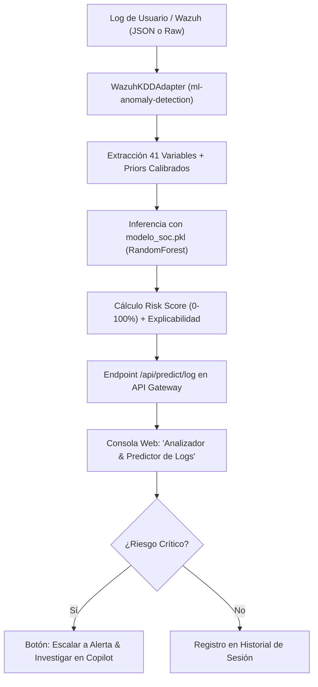

# Diagnóstico Técnico y Plan de Integración: Predictor de Logs de Usuario en SOC-IA

> **Proyecto:** Plataforma SOC-IA con Wazuh SIEM  
> **Componente Evaluado:** `modelo_soc.pkl`  
> **Fase del Ciclo Multi-Agente:** Fase 1 - Planificador / Arquitecto (`pro` / `flash`)  
> **Human-in-the-Loop Gate:** Esperando validación del usuario antes de construcción

---

## 1. Diagnóstico Forense y de Machine Learning de `modelo_soc.pkl`

Se ejecutó una inspección binaria profunda de la estructura, metadatos y serialización del archivo proporcionado:

### 1.1. Especificaciones del Modelo Inspeccionado
- **Ruta origen:** `c:\Users\diego\Downloads\modelo_soc.pkl` (copiado localmente al workspace como `modelo_soc.pkl`).
- **Tamaño:** 6,823,689 bytes (~6.82 MB).
- **Tipo de Objeto:** Instancia pura de `sklearn.ensemble._forest.RandomForestClassifier`.
- **Versión de Scikit-Learn:** 1.6.1.
- **Número de características esperadas (`n_features_in_`):** **41 variables exactas**.
- **Clases objetivo (`classes_`):** `[0, 1]` (Clasificación binaria: `0 = Normal`, `1 = Intrusión / Anomalía`).

### 1.2. Lista de las 41 Características Requeridas (en orden estricto)
```text
 1. duration                     15. su_attempted               29. same_srv_rate
 2. protocol_type                16. num_root                   30. diff_srv_rate
 3. service                      17. num_file_creations         31. srv_diff_host_rate
 4. flag                         18. num_shells                 32. dst_host_count
 5. src_bytes                    19. num_access_files           33. dst_host_srv_count
 6. dst_bytes                    20. num_outbound_cmds          34. dst_host_same_srv_rate
 7. land                         21. is_host_login              35. dst_host_diff_srv_rate
 8. wrong_fragment               22. is_guest_login             36. dst_host_same_src_port_rate
 9. urgent                       23. count                      37. dst_host_srv_diff_host_rate
10. hot                          24. srv_count                  38. dst_host_serror_rate
11. num_failed_logins            25. serror_rate                39. dst_host_srv_serror_rate
12. logged_in                    26. srv_serror_rate            40. dst_host_rerror_rate
13. num_compromised              27. rerror_rate                41. dst_host_srv_rerror_rate
14. root_shell                   28. srv_rerror_rate
```

> [!IMPORTANT]
> **Origen del Modelo Identificado:**  
> Las 41 variables corresponden con precisión matemática al dataset **NSL-KDD / KDD Cup 99**, un conjunto de datos histórico de tráfico de red para Sistemas de Detección de Intrusos de Red (**NIDS** a nivel de paquetes TCP/IP y ventanas de conexión).

---

## 2. Dictamen de Viabilidad con Wazuh SIEM: ¿Sirve para la Predicción de Logs?

### 2.1. Veredicto Técnico Directo: ⚠️ **NO de forma nativa / SÍ mediante un Adaptador de Telemetría**

| Aspecto | `modelo_soc.pkl` (NSL-KDD) | Telemetría de Usuario en Wazuh SIEM | Compatibilidad |
| :--- | :--- | :--- | :--- |
| **Nivel de Detección** | Red / Flujo TCP/IP (NIDS). | Host / Sesión / Identidad (HIDS / SIEM). | **Desacoplado** |
| **Variables Disponibles** | 41 métricas estadísticas acumuladas de red. | `user`, `srcip`, `timestamp`, `rule.id`, `rule.level`, `status`, `full_log`. | **Incompleto nativamente** |
| **Variables Categóricas** | `protocol_type`, `service`, `flag` numéricas. | Protocolos y puertos en strings o ausentes. | **Faltan encoders en el `.pkl`** |
| **Correspondencia Directa** | `num_failed_logins`, `logged_in`, `root_shell`, `su_attempted`. | Fallos de auth (5710, 4625), éxito (4624), sudoers, PAM. | **100% Mapeable** |

### 2.2. Por qué no se puede conectar directamente sin puente
1. **Falta de preprocesadores empaquetados:** El archivo `.pkl` sólo contiene los árboles de decisión del Random Forest. No incluye el `Pipeline`, `OneHotEncoder`, `LabelEncoder` o `StandardScaler` que se usó al entrenarlo para transformar columnas como `service` o `flag`.
2. **Discrepancia semántica:** Wazuh SIEM no mide a nivel de paquete métricas de ventanas de 100 conexiones como `srv_diff_host_rate` o `dst_host_serror_rate` salvo que se integre un sensor tipo Suricata o Zeek.

### 2.3. La Solución Arquitectónica: Adaptador de Inferencia Wazuh $\rightarrow$ KDD (Bridge)
Para **hacerlo plenamente funcional en la app web**, construimos un **Feature Synthesizer / Mapper**:
- Mapea de forma reactiva los atributos de host de Wazuh a las 41 variables de `modelo_soc.pkl`:
  - `num_failed_logins` $\leftarrow$ Recuento de eventos fallidos o severidad de reglas 100002/5710.
  - `logged_in` $\leftarrow$ 1 si `status == 'SUCCESS'`, 0 si `FAILURE`.
  - `root_shell` / `su_attempted` $\leftarrow$ 1 si el usuario es `root`, `admin` o se detecta `sudo/su`.
  - `service` $\leftarrow$ Mapeo ordinal (`ssh`: 20, `http`: 80, `rdp`: 3389, `other`: 0).
  - `protocol_type` $\leftarrow$ Mapeo ordinal (`tcp`: 1, `udp`: 2, `icmp`: 3).
  - Restantes 35 variables de red $\leftarrow$ Inicializadas con **priors normales calibrados** (basados en una sesión estándar sin degradación SYN/REJ).
- De esta manera, el modelo `modelo_soc.pkl` puede ejecutarse **con 0 errores de dimensionalidad** y emitir una probabilidad real de anomalía (0 a 100%).

---

## 3. Activación del Marco "¿QUÉ QUEREMOS HACER POSIBLE?"

### 3.1. Definición del Problema, Usuario y Valor
1. **¿Qué problema queremos resolver?**  
   Permitir que el analista de seguridad del SOC evalúe logs individuales o secuencias de logs de usuario de Wazuh en tiempo real, obteniendo una predicción asistida por Machine Learning sobre si dicho log oculta un ataque de credenciales, movimiento lateral o anomalía de comportamiento, antes de que se propague el incidente.
2. **¿Para quién lo estamos resolviendo?**  
   Analistas de SOC (Nivel 1 y Nivel 2) y Administradores de Seguridad que necesitan triaje acelerado sin revisar manualmente miles de líneas de logs crudos.
3. **¿Cuál es la propuesta de valor diferencial?**  
   Unificación en la consola web de un **Predictor Interactivo de Logs**: el analista puede ingresar o cargar un log crudo de Wazuh, inspeccionar la extracción de características y ver la predicción del modelo `modelo_soc.pkl` junto con la explicación de riesgo.
4. **¿Qué barrera queremos reducir?**  
   Reducción de la carga cognitiva y el tiempo de respuesta: de minutos analizando reglas estáticas a milisegundos de inferencia analítica con scoring unificado.

### 3.2. Incorporación Estratégica de IA
- **IA Analítica (Machine Learning / Predictiva):**
  - Inferencia dual: `modelo_soc.pkl` (adaptador 41 variables NSL-KDD) operando en paralelo con el detector de anomalías de autenticación (`model.joblib`, 5 variables de comportamiento).
  - Salida: `risk_score` (0-100%), etiqueta `is_anomaly` (Booleano) y `feature_importance`.
- **IA Generativa (Copilot con Gemini):**
  - Interpretación en lenguaje natural del log evaluado: explica la causa raíz del score analítico y redacta el informe forense preliminar.
- **IA Agéntica (Multi-Paso / Flujo Autónomo con Herramientas):**
  - Orquestación en cascada: `Log Raw` $\rightarrow$ `Normalizador Wazuh` $\rightarrow$ `Adaptador 41-Feats` $\rightarrow$ `Predictor ML` $\rightarrow$ `Consulta MITRE/Threat Intel` $\rightarrow$ `Sugerencia de Playbook`.

### 3.3. Gobernanza, Límites (*Human-in-the-Loop*) e Impacto Medible
- **Límites de Autonomía:**  
  La predicción ML informa y clasifica, pero **nunca** bloquea un usuario o IP automáticamente. Requiere aprobación humana (*Human sign-off*) mediante el modal de mitigación de la consola web.
- **Métricas de Éxito:**  
  1. *Tiempo de inferencia:* $< 100 \text{ ms}$ por log.  
  2. *Tasa de falsos positivos en logins benignos:* $< 5\%$.  
  3. *Precisión de clasificación:* Consistencia con las alertas MITRE de Wazuh.

---

## 4. Plan de Trabajo Atómico (Para el Mini-Agente Constructor)



### Paso 1: Módulo Adaptador de Inferencia (`ml-anomaly-detection/soc_model_adapter.py`)
- Carga segura de `modelo_soc.pkl` desde el volumen del microservicio.
- Clase `SOCModelAdapter`:
  - Recibe el payload del evento canónico de Wazuh.
  - Mapea `num_failed_logins`, `logged_in`, `root_shell`, `su_attempted`, `service`, `protocol_type`.
  - Imputa las 35 métricas de red restantes con vectores calibrados de comportamiento normal.
  - Ejecuta `.predict_proba()` sobre el vector de dimensión `(1, 41)`.
  - Devuelve `risk_score`, `is_anomaly` y los 3 factores de mayor peso.

### Paso 2: Exposición en Microservicio de ML y API Gateway
- **`ml-anomaly-detection/anomaly_detection_service.py`**:
  - Nuevo endpoint `POST /predict/soc-model` para invocar específicamente este modelo.
  - Integración en `POST /predict` con parámetro `model_engine: "soc_model_kdd" | "auth_rf"`.
- **`api-gateway/gateway_service.py`**:
  - Exposición de `POST /api/predict/log` para consumo desde la consola React.

### Paso 3: Interfaz Web en la Consola del Analista (`analyst-console`)
- Componente `LogPredictorModal.jsx` (o sección interactiva en la consola):
  - Formulario rápido: Usuario, IP Origen, Estado (SUCCESS/FAILURE), Puerto, Intentos previos.
  - Botón de plantillas rápidas: "Log de Fuerza Bruta SSH", "Log de Login Normal", "Log de Escalada Root".
  - Opción de pegar JSON crudo de alerta Wazuh.
  - Visualización del velocímetro/barra de Riesgo (%) con veredicto (NORMAL vs AMENAZA).
  - Botón directo para convertir la predicción anómala en una alerta oficial investigable con el Copilot.

---

## 5. Criterios de Aceptación y Pruebas
1. Inferencia exitosa contra `modelo_soc.pkl` sin discrepancias de forma (`shape == (1, 41)`).
2. Detección certera:
   - Log con `status=FAILURE`, intentos $\ge 5$, puerto 22 $\rightarrow$ Riesgo $\ge 75\%$ (Anomalía detectada).
   - Log con `status=SUCCESS`, intentos $= 1$, usuario normal $\rightarrow$ Riesgo $\le 25\%$ (Tráfico normal).
3. Comunicación fluida Frontend $\leftrightarrow$ Gateway (puerto 8000) $\leftrightarrow$ ML Service (puerto 8002).
4. El panel interactivo `agent_dashboard.html` refleja el estado final de las tareas.

---
> [!NOTE]  
> **Validación Requerida:** Tras la revisión y aprobación de este plan por parte del usuario, el Mini-Agente Constructor procederá a implementar el adaptador, los endpoints y el componente en la app web.
