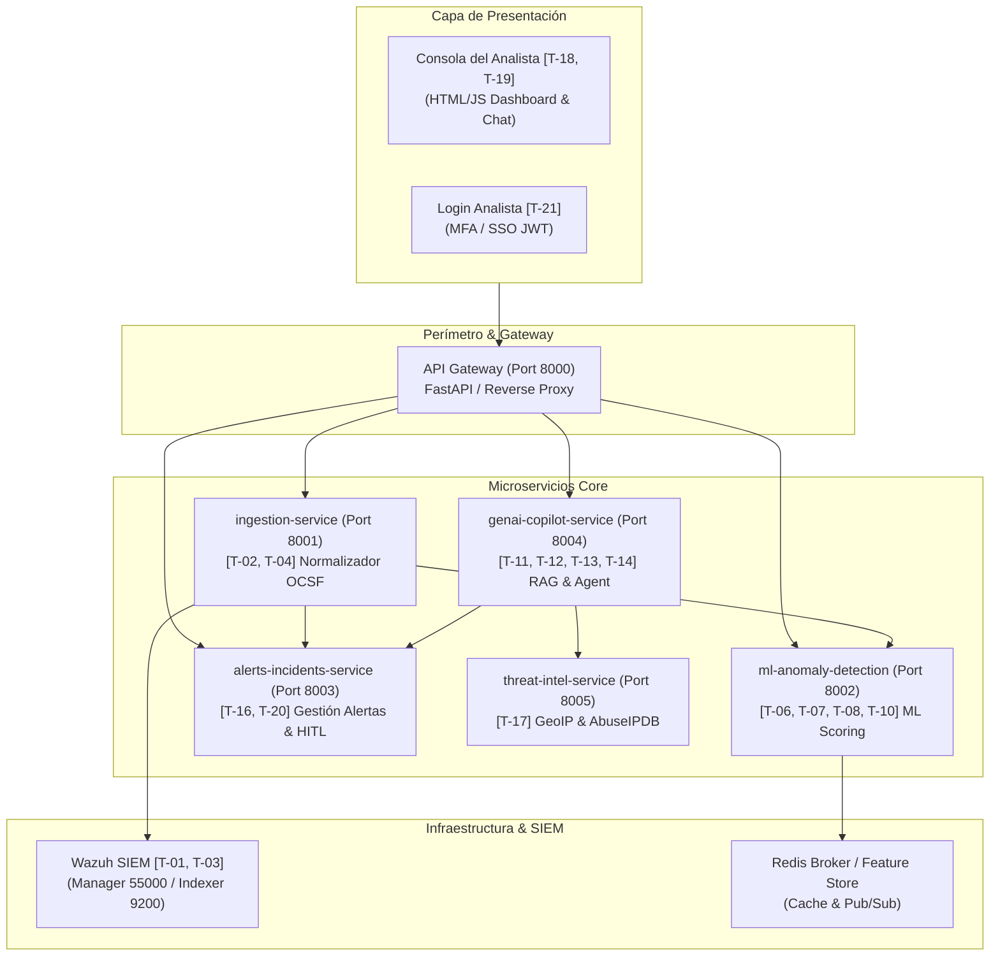

# Arquitectura de Software Basada en Microservicios: SOC-IA
**Centro de Operaciones de Seguridad Potenciado con Inteligencia Artificial**

Este documento formaliza la arquitectura de software del proyecto **SOC-IA**, diseñada a partir de los requerimientos y tarjetas del tablero de [Trello Oficial](https://trello.com/b/KtXEbkOl/soc-ia-centro-de-operaciones-de-seguridad-con-ia) y los modelos de contenedores C4 del sistema.

---

## 1. Marco Estratégico: "¿Qué Queremos Hacer Posible?"

### 1.1. Definición del Problema, Usuario y Valor
* **¿Qué problema queremos resolver?**
  * La fatiga de alertas y la saturación cognitiva en los Centros de Operaciones de Seguridad (SOC), donde los analistas pierden horas revisando cientos de intentos de inicio de sesión no correlacionados, ataques de fuerza bruta y accesos anómalos.
* **¿Para quién lo estamos resolviendo?**
  * **Analistas SOC (N1 / N2):** Operadores encargados de la detección, triaje y contención de incidentes.
  * **Líderes / Administradores de Seguridad:** Supervisan métricas, autorizan remediaciones críticas y configuran políticas.
  * **Científicos de Datos / MLOps:** Diseñan y retroalimentan los modelos de detección de anomalías.
* **¿Cuál es la propuesta de valor diferencial?**
  * Unificar la telemetría del SIEM (**Wazuh**) con **Machine Learning analítico** para calcular scores de riesgo objetivos, y un **Copiloto Generativo (GenAI / RAG)** que investiga, sintetiza playbooks del NIST/MITRE y formula planes de contención asistida en segundos.
* **¿Qué barrera queremos reducir?**
  * Reducir drásticamente el **MTTD** (Tiempo Medio de Detección) y el **MTTR** (Tiempo Medio de Respuesta), eliminando el análisis manual de logs crudos y la búsqueda fragmentada de guías forenses.

---

### 1.2. Incorporación Estratégica de Inteligencia Artificial

| Modalidad de IA | Microservicio Responsable | Capacidad que Aporta al Sistema |
| :--- | :--- | :--- |
| **IA Analítica** *(Machine Learning / Estadística)* | `ml-anomaly-detection` | Detección estadística de anomalías (Isolation Forest / Random Forest) sobre patrones de autenticación (hora, país, IPs externas, frecuencia de fallos, cuentas privilegiadas) generando un `risk_score` (0-100%). |
| **IA Generativa** *(Comprensión Multimodal & RAG)* | `genai-copilot-service` | Síntesis contextual de incidentes utilizando RAG indexado con **NIST SP 800-61 Rev 2** y tácticas **MITRE ATT&CK** (T1110, T1078), traduciendo telemetría cruda a recomendaciones en lenguaje natural. |
| **IA Agéntica** *(Autonomía & Function Calling)* | `genai-copilot-service` | Agente autónomo con llamadas a funciones (`tools`) capaz de consultar alertas, inspeccionar IoCs en bases de reputación y preparar órdenes estructuradas de remediación activa (*Active Response*). |

---

### 1.3. Gobernanza, Límites e Impacto Medible
* **Límites de Autonomía (Human-in-the-Loop):**
  * La IA **nunca** ejecuta un bloqueo de IP o aislamiento de host de forma automática e inadvertida.
  * El Copilot formula la recomendación y la orden técnica, pero exige la **confirmación y firma humana explícita (*sign-off*)** del Analista N2 o Administrador antes de despachar el comando a Wazuh Active Response.
* **Métricas de Éxito e Impacto:**
  1. Reducción > 70% en el tiempo de triaje de alertas de login.
  2. Tasa de falsos positivos inferior al 10% mediante retroalimentación activa (*Active Learning*).
  3. Trazabilidad forense del 100% de las mitigaciones aplicadas con responsable humano asociado.

---

## 2. Mapa de Microservicios y Cobertura de Tareas de Trello



### Relación con las Tarjetas de Trello:
* **Módulo 1: SIEM & Ingesta (Wazuh):**
  * `[T-01]` y `[T-02]`: Despliegue e ingesta JSON externo gestionados por `ingestion-service`.
  * `[T-03]` y `[T-04]`: Reglas de clasificación y generador dummy de tráfico.
* **Módulo 2: Machine Learning & Datos:**
  * `[T-06]`, `[T-07]`, `[T-08]`, `[T-10]`: Feature engineering y modelo de inferencia en `ml-anomaly-detection`.
  * `[T-09]`: Explicabilidad de factores en el payload de predicción (`contributing_features`).
* **Módulo 3: Chatbot GenAI & RAG:**
  * `[T-11]`, `[T-12]`, `[T-13]`: Orquestación del Copilot con RAG (NIST/MITRE) y tools en `genai-copilot-service`.
  * `[T-14]`: Mitigación asistida con aprobación humana (*HITL*).
* **Módulo 4: Web & Backend:**
  * `[T-16]`: Backend y API Gateway en `api-gateway` y `alerts-incidents-service`.
  * `[T-18]`, `[T-19]`: Dashboard interactivo y panel lateral de IA en `frontend/analyst-console`.
  * `[T-20]`: Feedback loop (Active Learning) para clasificación de TP/FP.
  * `[T-21]`, `[T-22]`: Pantalla y flujo de autenticación de analistas.

---

## 3. Estructura de Carpetas del Proyecto

```
soc-ia-microservices/
├── docker-compose.yml               # Orquestación de contenedores y redes
├── .env.example                     # Variables de entorno requeridas
├── ARCHITECTURE.md                  # Este documento maestro
├── shared/
│   └── schemas/
│       └── event_schema.py          # Esquema canónico OCSF de eventos y alertas
├── services/
│   ├── api-gateway/                 # Gateway perimetral con proxy y CORS (Puerto 8000)
│   │   ├── gateway_service.py       # Despacho de API y enrutador frontend
│   │   ├── Dockerfile
│   │   └── requirements.txt
│   ├── ingestion-service/           # Ingesta de eventos y normalización (Puerto 8001)
│   │   ├── ingestion_service.py     # Pipeline de ingesta y normalización OCSF
│   │   ├── Dockerfile
│   │   └── requirements.txt
│   ├── ml-anomaly-detection/        # Inferencia de anomalías y scoring (Puerto 8002)
│   │   ├── anomaly_detection_service.py # API de inferencia estadística ML
│   │   ├── model.py                 # Lógica de detección de anomalías
│   │   ├── Dockerfile
│   │   └── requirements.txt
│   ├── alerts-incidents-service/    # Gestión de incidentes y persistencia (Puerto 8003)
│   │   ├── alerts_incidents_service.py # Ciclo de vida de alertas y órdenes HITL
│   │   ├── Dockerfile
│   │   └── requirements.txt
│   ├── genai-copilot-service/       # Copiloto RAG con Gemini / LangChain (Puerto 8004)
│   │   ├── copilot_service.py       # API de interacción con el Copilot IA
│   │   ├── agent.py                 # Agente RAG contextual (MITRE & NIST)
│   │   ├── Dockerfile
│   │   └── requirements.txt
│   └── threat-intelligence-service/ # Enriquecimiento GeoIP y reputación (Puerto 8005)
│       ├── threat_intel_service.py  # Cache y consulta de reputación de IoCs
│       ├── Dockerfile
│       └── requirements.txt
└── frontend/
    └── analyst-console/
        ├── css/                     # Hojas de estilo modulares
        │   ├── dashboard.css        # Estilos de la consola de alertas y copilot
        │   └── login.css            # Estilos del formulario de acceso y MFA
        ├── analyst_dashboard.html   # Consola del analista (Dashboard + Chatbot)
        └── analyst_login.html       # Formulario de autenticación del operador
```

---

## 4. Guía de Ejecución

### Opción A: Despliegue con Docker Compose (Recomendado)
```bash
cd soc-ia-microservices
docker-compose up --build
```
Una vez levantado:
* **Consola del Analista:** [http://localhost:8000/](http://localhost:8000/)
* **Documentación Swagger del API Gateway:** [http://localhost:8000/docs](http://localhost:8000/docs)
* **Pantalla de Login:** [http://localhost:8000/login](http://localhost:8000/login)

### Opción B: Ejecución Individual para Desarrollo
Cada microservicio es completamente autónomo y puede iniciarse con su respectivo script:

* **API Gateway (8000):**
  ```bash
  cd services/api-gateway && uvicorn gateway_service:app --port 8000 --reload
  ```
* **Ingestion Service (8001):**
  ```bash
  cd services/ingestion-service && uvicorn ingestion_service:app --port 8001 --reload
  ```
* **ML Anomaly Detection (8002):**
  ```bash
  cd services/ml-anomaly-detection && uvicorn anomaly_detection_service:app --port 8002 --reload
  ```
* **Alerts & Incidents Service (8003):**
  ```bash
  cd services/alerts-incidents-service && uvicorn alerts_incidents_service:app --port 8003 --reload
  ```
* **GenAI Copilot Service (8004):**
  ```bash
  cd services/genai-copilot-service && uvicorn copilot_service:app --port 8004 --reload
  ```
* **Threat Intelligence Service (8005):**
  ```bash
  cd services/threat-intelligence-service && uvicorn threat_intel_service:app --port 8005 --reload
  ```
